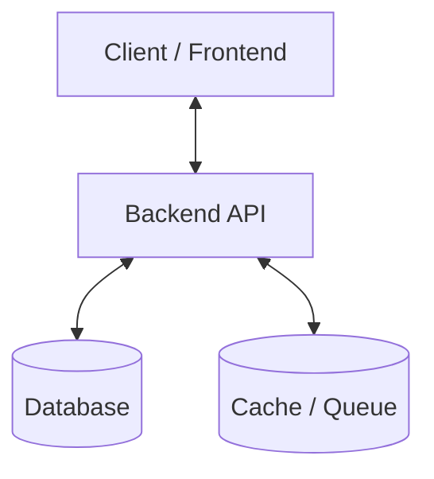

# System Architecture & Purpose

## 1. Project Purpose & Product Vision
[Describe the core problem this project solves, who the users are, and the business goals.]

## 2. Infrastructure & Topology
[Describe the infrastructure, cloud providers, container setup, and external services.]

## 3. Core Modules & Components
[List primary packages, modules, or microservices and their responsibilities.]

## 4. Data Flow & Lifecycles
[Detail request lifecycle, authentication flow, background tasks, and event pipelines.]
