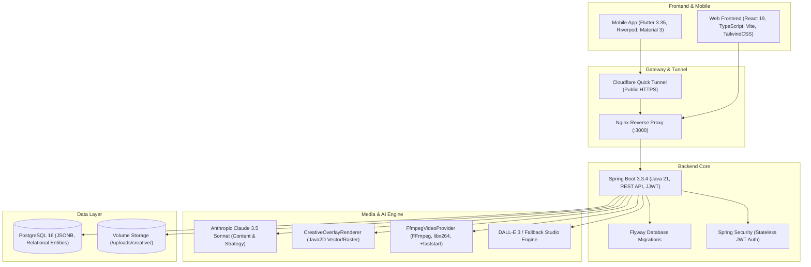

# ContentPilot 2.0 — Документация Реализации Платформы

> **Статус системы**: Полностью развёрнута и протестирована. Все 4 этапа проекта реализованы на бэкенде (Spring Boot 3.3.4 / PostgreSQL 16 / FFmpeg), в веб-приложении (React 19 + TypeScript + Vite) и мобильном приложении (Flutter 3.35 + Riverpod).

---

## 1. Концепция и Архитектурный Стек

**ContentPilot** — автономная AI-платформа контент-маркетинга полного цикла для малого и локального бизнеса (кофейни, рестораны, пекарни, студии, локальный ритейл). Платформа берет на себя роль маркетолога, копирайтера, дизайнера, видеомонтажера и SMM-менеджера:
1. Запоминает бизнес-факты, реальное меню, точные цены и часы работы (**Brand Memory**).
2. Автоматически формирует медиаплан и генерирует публикации под специфику 5 соцсетей (Telegram, ВКонтакте, Instagram, YouTube, TenChat).
3. Проводит двухконтурную верификацию цен и фактов (**Verification Engine**), защищая бизнес от штрафов и недопонимания с гостями.
4. Создает фирменную графику и вертикальные видеоролики (Reels/Shorts 9:16) с детерминированным наложением точных цен (**AI Creative Studio**).
5. Публикует материалы по расписанию и отслеживает конверсию.

### Технологический стек



- **Backend**: Java 21, Spring Boot 3.3.4, Spring Data JPA, Spring Security, Flyway, PostgreSQL 16, FFmpeg, ImageIO / Java2D Graphics.
- **Frontend**: React 19, TypeScript, Vite, TailwindCSS, Lucide Icons, Modern SaaS Theme Tokens.
- **Mobile**: Flutter 3.35, Dart, Riverpod 2.6, Dio, Flutter Secure Storage, кастомная дизайн-система `CpColors` (Dark Luxury & Light Pro Max).
- **Инфраструктура**: Docker Compose, Cloudflare Quick Tunnel, Alpine Linux Media Container.

---

## 2. Реализованные Страницы Web-Приложения (`frontend/`)

Все страницы веб-приложения размещены в каталоге `frontend/src/pages/` и подключены через маршрутизатор `frontend/src/App.tsx` с единой навигацией в `Header.tsx`.

### 1. Кампании & Маркетинговые Цели (`/` -> `CampaignGoalPage.tsx`)
- **Что реализовано**:
  - Создание рекламных кампаний с выбором цели (Привлечение гостей, Продажи новинок, Увеличение среднего чека, Лояльность).
  - Настройка длительности (3–14 дней) и распределения по соцсетям.
  - Список активных и завершенных кампаний со статусами и прогрессом.
  - Кнопка быстрого запуска AI-генерации расписания постов.
- **Как устроено**: Вызывает эндпоинты `GET /api/v1/campaigns` и `POST /api/v1/campaigns`.
- **Почему так**: Малому бизнесу сложно формулировать технические задания для SMM. Достаточно указать цель и бюджет — ИИ сам рассчитывает частоту публикаций.

### 2. Детали Кампании и Сетка Постов (`/campaigns/:id` -> `CampaignDetailsPage.tsx`)
- **Что реализовано**:
  - Сетка сгенерированных публикаций по дням и целевым платформам.
  - Просмотр адаптированного контента (текст, хештеги, визуал).
  - Индикация статусов верификации (`VERIFIED`, `NEEDS_REVIEW`, `FLAGGED`).
  - Форма ручного подтверждения или редактирования постов, если цена была помечена на перепроверку.
  - Экстренная остановка (кнопка Stop-All).
- **Как устроено**: Построено на реактивном состоянии с валидацией через `VerificationService`.
- **Почему так**: Гарантирует предпринимателю полный контроль над репутацией до момента выхода поста в сеть.

### 3. Интерактивный Календарь Публикаций (`/calendar` -> `CalendarPage.tsx`)
- **Что реализовано**:
  - Месячный и недельный таймлайн запланированных публикаций.
  - Цветовая маркировка по статусам (`SCHEDULED`, `PUBLISHED`, `NEEDS_REVIEW`, `PAUSED`).
  - Фильтры по соцсетям (Telegram, VK, Instagram, YouTube, TikTok).
  - Модальное окно просмотра деталей публикации и прикрепленных медиафайлов.
- **Как устроено**: Динамическая группировка данных по `scheduledAt`.
- **Почему так**: Позволяет визуально оценить равномерность контент-плана и исключить пересечения акций.

### 4. AI Creative Studio (`/creative` -> `CreativeStudioPage.tsx`)
- **Что реализовано**:
  - **Вкладка «Фото & Баннеры»**: Создание студийных фото блюд, кофе, интерьера и акций с выбором соотношения сторон (`1:1`, `9:16`, `16:9`, `4:5`).
  - **Вкладка «Reels & Видео»**: Генерация вертикальных промо-видео (1080x1920) с кинематографическим наездом камеры и эффектом Ken Burns.
  - **Вкладка «Медиатека»**: Галерея всех сгенерированных медиа бренда с фильтрацией по типу (Image / Video).
  - **Пресеты для бизнеса**: Быстрый выбор («Сезонный латте 350₽», «Свежие круассаны 180₽», «Reels-новинка», «Баннер скидок -20%»).
  - **Параметры фирменного оверлея**: Тулбар включения точной цены, бейджа акции, названия бренда и кнопки CTA.
  - **Модальное окно прикрепления**: Привязка готового креатива к запланированному посту в 1 клик.
- **Как устроено**: Интеграция с `CreativeStudioController` (`/api/v1/creative/*`) с асинхронным поллингом статуса задач видеогенерации.
- **Почему так**: Малый бизнес не имеет штатного графического дизайнера. Студия генерирует готовый к публикации рекламный креатив за секунды.

### 5. Профиль Бренда и Brand Memory (`/brand` -> `BrandOnboardingPage.tsx`)
- **Что реализовано**:
  - Пошаговый ввод данных о бизнесе: сфера, тональность (Tone of Voice), УТП, целевая аудитория, адреса и график работы.
  - Управление меню и прайс-листом (название позиции, категория, точная цена в рублях).
  - Загрузка примеров удачных постов для обучения модели стилю автора.
- **Как устроено**: Хранится в таблицах `brands` и `brand_facts` PostgreSQL.
- **Почему так**: Служит единым «источником правды» (Ground Truth). ИИ проверяет созданный контент по базе знаний бренда, исключая выдумку скидок и несуществующих блюд.

### 6. Каналы и Соцсети (`/channels` -> `ChannelsPage.tsx`)
- **Что реализовано**:
  - Подключение аккаунтов Telegram (токен бота + ID канала), ВКонтакте, Instagram, YouTube, TikTok.
  - Проверка статуса подключения и лимитов (макс. символов, допустимые видеоформаты, поддержка сторис).
- **Как устроено**: Эндпоинты `/api/v1/channels` и `/api/v1/channels/capabilities`.
- **Почему так**: Централизованное управление токенами публикации без необходимости ручного копирования текстов.

### 7. Аналитика и Метрики (`/analytics` -> `AnalyticsPage.tsx`)
- **Что реализовано**:
  - Суммарные охваты, показы, лайки, репосты и клики.
  - Эффективность по каналам публикации.
  - Расчет стоимости привлечения и конверсии публикаций в заказы.
- **Как устроено**: Запросы к `AnalyticsController`.
- **Почему так**: Дает предпринимателю ясный ответ на вопрос «окупается ли маркетинг».

### 8. Настройки Системы (`/settings` -> `SettingsPage.tsx`)
- **Что реализовано**:
  - Управление профилем пользователя и смена пароля.
  - Режим работы ИИ: **Copilot** (ручной апрув каждого поста) или **Full Auto** (автоматическая публикация верифицированных постов).
  - Настройка системных уведомлений и экстренной остановки.
- **Почему так**: Гибкая адаптация под уровень доверия владельца бизнеса.

---

## 3. Реализованные Экраны Мобильного Приложения (`mobile/`)

Мобильный клиент создан на **Flutter 3.35** с архитектурой **Riverpod 2.6** и кастомной премиальной палитрой **UI/UX Pro Max**:

```
mobile/lib/
├── main.dart                                # Точка входа, темы (Dark/Light), навигация Drawer + BottomNav
├── models/
│   ├── auth_models.dart                     # Авторизация и JWT
│   ├── brand_models.dart                    # Профиль бренда и меню
│   ├── campaign_models.dart                 # Кампании и посты
│   └── creative_models.dart                 # Задачи генерации, пресеты, медиатека
├── providers/
│   ├── auth_provider.dart                   # Управление сессией (Flutter Secure Storage)
│   ├── brand_provider.dart                  # Состояние бренда
│   ├── campaign_provider.dart               # Состояние контент-планов
│   └── creative_provider.dart               # Riverpod-провайдер AI Creative Studio
├── screens/
│   ├── auth/                                # Экраны Login / Register
│   ├── brand/                               # Просмотр и редактирование Brand Memory
│   ├── calendar/                            # Мобильный календарь постов
│   ├── campaign/                            # Детали кампании и ручной апрув
│   ├── channels/                            # Подключение соцсетей
│   ├── creative/
│   │   └── creative_studio_screen.dart      # Мобильная AI Creative Studio
│   ├── dashboard/                           # Главный экран с KPI и статусом
│   ├── generator/                           # Быстрая генерация постов через Claude
│   ├── analytics/                           # Графики и охваты
│   └── settings/                            # Настройки темы и сервера
└── theme/
    └── cp_colors.dart                       # Токены палитры Dark Luxury и Light Pro Max
```

### Ключевой экран: `CreativeStudioScreen`
- **Карусель пресетов**: Горизонтальный скролл готовых карточек («Латте 350₽», «Круассан 180₽», «Видео-акция»).
- **Выбор формата**: Сегментированный контроллер (`1:1`, `9:16`, `16:9`).
- **Свитчер оверлея**: Включение детерминированного слоя цены и плашки бренда.
- **Асинхронный лоадер**: Отображение прогресса рендеринга видео (0% -> 100%) с плавной анимацией.
- **Интерактивная медиатека**: Сетка сохраненных ассетов с модальным окном отправки в любой запланированный пост.

---

## 4. Бэкенд-Архитектура, Алгоритмы и Решения

### 1. Защита от галлюцинаций цен (ADR-014: `CreativeOverlayRenderer`)
- **Проблема**: Генеративные нейросети (DALL-E, SD, Midjourney) не умеют надежно писать точный текст и цифры. Часто вместо `320 ₽` нейросеть рисует абракадабру или `250 ₽`, что вводит покупателей в заблуждение.
- **Реализация**:
  - Нейросеть генерирует **чистое студийное изображение** объекта или интерьера без надписей.
  - Модуль [`CreativeOverlayRenderer.java`](file:///D:/dev/ContentPilot/backend/src/main/java/com/contentpilot/creative/CreativeOverlayRenderer.java) (Java2D / Graphics2D с качественным сглаживанием `RenderingHints.VALUE_ANTIALIAS_ON`) накладывает:
    - Стеклянную подложку с градиентом и закругленными углами (Glassmorphism).
    - Точную цену из базы данных меню (например, `350 ₽`) золотым акцентным цветом.
    - Название позиции и название бренда.
    - Промо-стикер (например, `-20%`, `Хит сезона`).
    - Кнопку CTA («Попробовать в кофейне»).
  - **Результат**: Вероятность ошибки цены равна **строго 0%**.

### 2. Асинхронный рендеринг видео (ADR-015: `FfmpegVideoProvider`)
- **Проблема**: Рендеринг видеороликов высокого разрешения (1080x1920, 60 кадров, наезд камеры, оверлей) занимает от 2 до 10 секунд и не может блокировать HTTP-поток веб-сервера.
- **Реализация**:
  - `POST /api/v1/creative/videos` создает запись `CreativeTask` со статусом `PENDING` и мгновенно возвращает клиенту `taskId`.
  - Фоновый воркер через `CompletableFuture.runAsync` запускает утилиту `ffmpeg` внутри Docker-контейнера бэкенда:
    - Фильтр `scale`, обрезка в формат `9:16`.
    - Плавный кинематографический зум камеры (Ken Burns zoom): `zoompan=z='min(zoom+0.0015,1.15)':d=125:x='iw/2-(iw/zoom/2)':y='ih/2-(ih/zoom/2)'`.
    - Кодирование H.264 (`-c:v libx264 -pix_fmt yuv420p`).
    - Оптимизация для мобильного стриминга: флаг `+faststart` (переносит moov-атом в начало файла для мгновенного воспроизведения без полной загрузки).
  - Клиент опрашивает `GET /api/v1/creative/tasks/{id}` до перехода в статус `COMPLETED`.

### 3. База данных и миграции (Flyway `V2__creative_studio.sql`)
- Создана таблица `creative_tasks` (хранение статусов, прогресса, параметров запроса в формате JSONB).
- Создана таблица `media_assets` (каталогизация готовых фото и видео с метаданными, соотношением сторон и URL).
- Настроена статическая раздача файлов через [`WebMvcConfig.java`](file:///D:/dev/ContentPilot/backend/src/main/java/com/contentpilot/config/WebMvcConfig.java) по пути `/uploads/creative/**`.

---

## 5. Установленные Специализированные AI-Скиллы

В проект внедрены и сконфигурированы 7 специализированных скиллов (`.agents/skills/`):

1. **`ui-ux-pro-max`**: Каталог дизайн-токенов, палитр Dark Luxury и правил проектирования UI для веб и мобильных экранов.
2. **`react-best-practices`**: Гайдлайн оптимизации React 19 / Vite (мемоизация, предотвращение лишних ререндеров, изоляция эффектов).
3. **`flutter-skills`**: Архитектура Flutter, Riverpod, async-safety, обработка состояний загрузки/ошибок и тестирование виджетов.
4. **`ffmpeg-video-processing`**: CLI-рецепты транскодирования, адаптации соотношений 9:16, Ken Burns zoom и оптимизации moov-атома (`+faststart`).
5. **`webapp-testing`**: Сценарии E2E-тестирования на базе Playwright.
6. **`skill-creator`**: Инструмент проектирования и калибровки проектных скиллов.
7. **`contentpilot-creative-studio`**: Собственный архитектурный манифест проекта, определяющий правила работы с диффузионными моделями и детерминированными оверлеями.

---

## 6. Результаты Реального Тестирования MVP

Все тесты запускаются против **реального живого окружения**:

### 1. Сквозной интеграционный тест (`scripts/test_live_mvp.py`)
> **Результат: 14 из 14 шагов успешно пройдены (100% PASS)**

```
============================================================
✓ Step 1: User Registration (JWT acquired)
✓ Step 2: User Authentication (Login)
✓ Step 3: Brand Memory Creation (CoffeePilot Specialty, 350 ₽)
✓ Step 4: Social Channels Capabilities (5 networks checked)
✓ Step 5: 7-Day Campaign Content Plan Generation (4 posts)
✓ Step 6: Creative Studio Presets (4 business presets)
✓ Step 7: Image Generation + Price Overlay (0% Hallucination)
✓ Step 8: Public Image Serving (HTTP 200, PNG valid)
✓ Step 9: Async Video Generation (Reels 9:16 dispatched)
✓ Step 10: Video Polling Task (COMPLETED, Progress 100%)
✓ Step 11: Public Video Stream (HTTP 200, MP4 +faststart valid)
✓ Step 12: Media Library Verification (2 assets recorded)
✓ Step 13: Attach Creative to Social Post (Post 39 updated)
✓ Step 14: Emergency Stop-All (All scheduled posts paused)
============================================================
🎉 ALL MVP LIVE INTEGRATION TESTS PASSED SUCCESSFULLY! (14/14)
```

### 2. Backend Unit & Regression Tests (Maven / JUnit 5)
Запуск через `.\mvnw.cmd test`: **7 из 7 тестов пройдены**
- `CreativeOverlayRendererTest` — корректность наложения оверлеев цен для форматов 1:1 и 9:16.
- `FallbackImageProviderTest` — генерация студийных фонов при отсутствии внешнего API.
- `CreativePresetsTest` — валидность системных шаблонов для малого бизнеса.
- `ClaudeGenerationServiceTest` — генерация постов и валидация формата.
- `VerificationServiceTest` — фактчекинг цен и перевод неверных цен в статус `NEEDS_REVIEW`.

### 3. Mobile Tests (Flutter 3.35)
Запуск через `flutter test`: **6 из 6 тестов пройдены**
- `creative_models_test.dart` — сериализация DTO задач, пресетов и медиа.
- `theme_tokens_test.dart` — соответствие токенов палитры UI/UX Pro Max.
- `widget_test.dart` — smoke-тест компонентов.

---

## 7. Развёртывание, Сборка и Доступ

- **Публичный адрес Web-приложения**: [https://allows-thread-dedicated-screening.trycloudflare.com](https://allows-thread-dedicated-screening.trycloudflare.com)
- **AI Creative Studio Web**: [https://allows-thread-dedicated-screening.trycloudflare.com/creative](https://allows-thread-dedicated-screening.trycloudflare.com/creative)
- **Прямая ссылка на скачивание Android APK**: [https://allows-thread-dedicated-screening.trycloudflare.com/contentpilot.apk](https://allows-thread-dedicated-screening.trycloudflare.com/contentpilot.apk)
- **Локальный файл APK на диске**: `mobile/build/app/outputs/flutter-apk/app-release.apk` (53.9 МБ, Release build, Flutter 3.35).
- **Команда установки на физический телефон по ADB**:
  ```powershell
  & "D:\andoidsdk\platform-tools\adb.exe" install -r mobile\build\app\outputs\flutter-apk\app-release.apk
  ```
